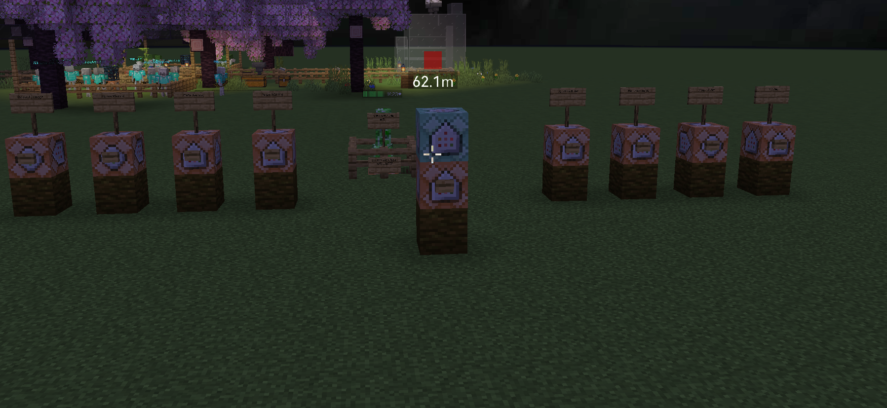
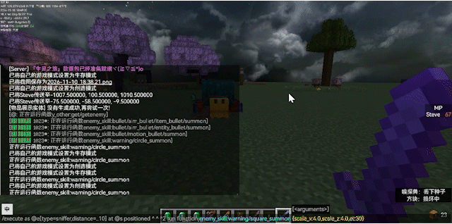
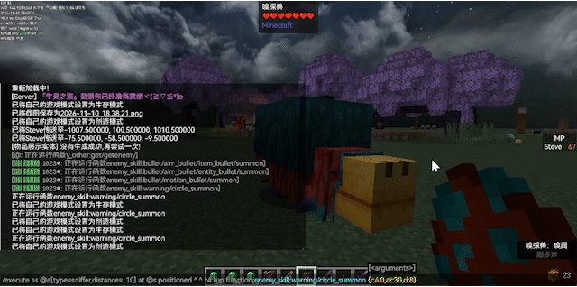
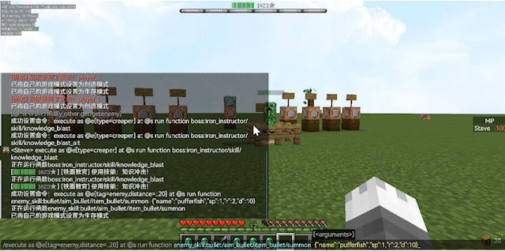
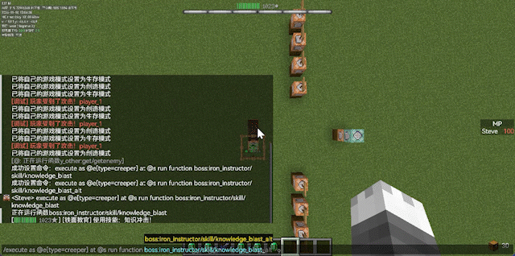

# 敌人技能系统 (Enemy Skill System)

---

## 系统概述

**敌人技能系统**是一个模块化的技能框架，为敌人和BOSS提供丰富的攻击模式。系统采用**宏函数接口**设计，高度参数化，易于调用和扩展。

地图中的测试区域如图所示,在这里就可以使用了.记得每次过来都要按下栅栏里的命令方块召唤那只苦力怕,因为这里的测试函数是以这个苦力怕为基准执行的.

### 









### 技术实现原理

#### 子弹移动系统

系统使用**光灵箭（spectral_arrow）+ display骑乘**的方案实现子弹移动：

1. **光灵箭作为载体** - 这样子做是可以复用MC原版的物理引擎.我当时试过TP,用TP的话子弹的移动会一卡一卡的.
2. **材质包隐藏箭体** - 通过资源包将光灵箭的材质设置为**完全透明**
3. **display骑乘显示** - block_display/item_display骑乘在箭上，展示自定义外观
4. **自动移动** - 利用箭的Motion实现移动，无需每tick手动传送

需要注意的是,因为实体有骑乘,它的中心位置是有偏移的,所以这个 boss 的攻击只能用作大概的范围,不能用作精细的攻击.所以说,当时我做地图的想法是,所有的攻击都只用很宽泛的攻击,让玩家比较好躲.如果你要修改的话,可以去修正一下这个偏移,我只在一部分子弹中做了这个偏移的修正参数.

有些 boss 的攻击方式可能导致：骑乘中上面的 block display 继续射击,但是下面被骑乘的光灵剑已经被清除了.这种情况下,我的解决方法是直接在这个 boss 的场景里,写一个定时全部清除的指令

#### 攻击预警系统

预警系统是为了**警示玩家即将到来的攻击，提供躲避机会**.

**设计理念：**

- 📢 **提前告知** - 在伤害触发前显示攻击范围
- ⏱️ **反应时间** - 给玩家足够的时间做出反应
- 🔗 **接口配合** - 一般与延迟伤害接口一起使用

**典型组合：**
```mcfunction
# 1. 显示预警（告知玩家）
function enemy_skill:warning/circle_summon {r:3.0, et:20, d:0}

# 2. 延迟伤害（20tick后触发，与预警同步）
function enemy_skill:delayed_damage/summon {r:3, d:10, t:20}
```

**应用场景：**
- BOSS范围技能提示
- 地面爆炸预告
- 

---

## 核心接口

### 🔫 子弹系统 (Bullet)

#### 1. motion_bullet - 动量子弹（直线发射）

**路径**: `enemy_skill:bullet/motion_bullet/summon`  
**类型**: 宏函数

**接口签名**:
```mcfunction
function enemy_skill:bullet/motion_bullet/summon {
    type: "block_display" | "item_display",
    name: "方块ID或物品ID",
    mx: 小数,    # X轴动量
    my: 小数,    # Y轴动量
    mz: 小数,    # Z轴动量
    t: 整数,     # 存在时间(tick)
    scale: 小数, # 视觉大小
    dr: 整数,    # 伤害半径(格)
    damage: 整数, # 伤害值
    tx: 小数,    # X轴视觉偏移
    ty: 小数,    # Y轴视觉偏移
    tz: 小数     # Z轴视觉偏移
}
```

**调用示例**:
```mcfunction
# 向东发射橡木原木
execute as @e[tag=enemy] at @s run function enemy_skill:bullet/motion_bullet/summon {
    type:"block_display",
    name:"minecraft:oak_log",
    mx:2.0, my:0.0, mz:0.0,
    t:100, scale:1, dr:2, damage:10,
    tx:0, ty:0, tz:0
}

# 向上发射书本（铁面教官技能）
execute at @s run function enemy_skill:bullet/motion_bullet/summon {
    type:"item_display",
    name:"minecraft:book",
    mx:-0.375, my:0.0, mz:0.0,
    t:200, scale:1.2, dr:1, damage:8,
    tx:0, ty:0, tz:0
}
```

---

#### 2. y_bullet - 上下颠倒子弹

**路径**: `enemy_skill:bullet/y_bullet/summon`  
**类型**: 宏函数

**接口签名**: 与 `motion_bullet` 相同

**用途**: 从上往下发射的子弹（如坠落的紫水晶块）

**调用示例**:
```mcfunction
# 从上往下坠落紫水晶块（紫晶核心BOSS技能）
execute at @s positioned ~ ~15 ~ run function enemy_skill:bullet/y_bullet/summon {
    type:"block_display",
    name:"minecraft:amethyst_block",
    mx:0.0, my:-0.5, mz:0.0,
    t:100, scale:4, dr:0, damage:0,
    tx:-2, ty:-5, tz:2
}
```

---

#### 3. aim_bullet - 瞄准子弹

因为其实他这个瞄准子弹是没有做 item display 的朝向瞄准的,所以如果你想用 item display 做剑的发射效果,就不要搞斜着发射,把剑搞成平的发射.而当时弄这个,我是没有打算搞 item display 的,我就是想搞一些对称的一些东西来做子弹.

**路径**: 

- `enemy_skill:bullet/aim_bullet/item_bullet/summon` (物品子弹)
- `enemy_skill:bullet/aim_bullet/entity_bullet/summon` (实体子弹)

**类型**: 宏函数

**接口签名**:
```mcfunction
# item_bullet
function enemy_skill:bullet/aim_bullet/item_bullet/summon {
    name: "物品ID",
    sp: 整数,    # 速度
    r: 整数,     # 伤害半径(格)
    d: 整数      # 伤害值
}
```

**特点**: 
- 自动瞄准最近的玩家
- 敌人会转向玩家
- 固定存在时间120tick

**调用示例**:
```mcfunction
# 发射铁剑瞄准玩家
execute as @e[tag=enemy] at @s run function enemy_skill:bullet/aim_bullet/item_bullet/summon {
    name:"iron_sword",
    sp:1, r:2, d:10
}

# 发射钻石剑，速度更快
execute as @e[tag=enemy] at @s run function enemy_skill:bullet/aim_bullet/item_bullet/summon {
    name:"diamond_sword",
    sp:2, r:3, d:15
}
```

---

### ⚠️ 预警系统 (Warning)

#### 1. circle_summon - 圆形预警（红色）

**路径**: `enemy_skill:warning/circle_summon`  
**类型**: 宏函数

**接口签名**:
```mcfunction
function enemy_skill:warning/circle_summon {
    r: 小数,     # 半径(格)
    et: 整数,    # 存在时间(tick)
    d: 整数      # 伤害值（0=不造成伤害）
}
```

**特点**:
- 使用粘液球（slime_ball）显示
- 红色粒子效果
- 可选择是否自动造成伤害(因为一般情况下,我最初的打算是这个预警和造成伤害是分开的,不过,如果让它自己可以造成伤害的话,就可以少写一行嘛)

**调用示例**:
```mcfunction
# 标准半径2格圆形，20tick停留，8点伤害
execute as @e[tag=enemy] at @s run function enemy_skill:warning/circle_summon {
    r:2.0, et:20, d:8
}

# 大范围半径4格，长时间停留（40tick），12点伤害
execute as @e[tag=enemy] at @s run function enemy_skill:warning/circle_summon {
    r:4.0, et:40, d:12
}

# 用于拟合复杂形状，不自动造成伤害（手动控制）
execute as @e[tag=enemy] at @s run function enemy_skill:warning/circle_summon {
    r:2.0, et:20, d:0
}
```

---

#### 2. purple_summon - 紫色圆形预警

**路径**: `enemy_skill:warning/purple_summon`  
**类型**: 宏函数

**接口签名**: 与 `circle_summon` 相同

**特点**:
- 使用粘土球（clay_ball）显示（已改材质为紫色）
- 紫色粒子效果
- 更高的音调

当时这个紫色的预告是想和红色的预告区分开来，比如说红色预告的是不可跳跃躲避的攻击，但是如果是紫色的预告，就表示这个攻击可以通过跳跃来躲避。这算是一个大饼了，我的项目目前并没有实现玩家跳跃躲避的这个逻辑。

**调用示例**:

```mcfunction
# 紫色圆形预警，半径3格
execute as @e[tag=boss] at @s run function enemy_skill:warning/purple_summon {
    r:3.0, et:30, d:10
}
```

---

#### 3. square_summon - 方形预警

**路径**: `enemy_skill:warning/square_summon`  
**类型**: 宏函数

**接口签名**:
```mcfunction
function enemy_skill:warning/square_summon {
    scale_x: 小数,  # X轴缩放（宽度）
    scale_z: 小数,  # Z轴缩放（长度）
    et: 整数        # 存在时间(tick)
}
```

**特点**:
- 使用潜影壳（shulker_shell）显示
- **没有伤害参数** - 方形范围判定复杂，需手动处理伤害
- 召唤在敌人前方3格

**调用示例**:
```mcfunction
# 标准1格×1格方形，20tick停留
execute as @e[tag=enemy] at @s run function enemy_skill:warning/square_summon {
    scale_x:1.0, scale_z:1.0, et:20
}

# 2格×2格大方形，长时间停留（40tick）
execute as @e[tag=enemy] at @s run function enemy_skill:warning/square_summon {
    scale_x:2.0, scale_z:2.0, et:40
}

# 3格×1格长条形（水之骑士横扫技能）
execute positioned -811 99.9 1002 run function enemy_skill:warning/square_summon {
    scale_x:35.0, scale_z:5.0, et:50
}
```

---

### ⏰ 延迟伤害 (Delayed Damage)

**路径**: `enemy_skill:delayed_damage/summon`  
**类型**: 宏函数

**接口签名**:
```mcfunction
function enemy_skill:delayed_damage/summon {
    r: 整数,     # 半径(格)
    d: 整数,     # 伤害值
    t: 整数      # 延迟时间(tick)
}
```

**特点**:
- 召唤不可见的marker实体
- 倒计时结束后对范围内玩家造成伤害
- 通常配合预警系统使用

**调用示例**:
```mcfunction
# 半径2格，8点伤害，20tick后触发
execute as @e[tag=boss] at @s run function enemy_skill:delayed_damage/summon {
    r:2, d:8, t:20
}

# 大范围延迟伤害，半径3格，12点伤害，40tick后触发
execute as @e[tag=elite] at @s run function enemy_skill:delayed_damage/summon {
    r:3, d:12, t:40
}
```

---

### 💀 死亡触发 (Deathrattle)

**路径**: `enemy_skill:deathrattle/manager`  
**类型**: 普通函数（无参数）

**用途**: 统一管理敌人死亡时触发的技能

**调用方式**: 在 `z_loop:entity_manager` 中调用

---

## 调用链追踪

### 子弹系统调用链

#### motion_bullet 调用流程

```
调用入口（BOSS/敌人技能函数）
    ↓
enemy_skill:bullet/motion_bullet/summon (宏函数)
    ↓
├─ 召唤光灵箭（spectral_arrow）
│   └─ 设置 Motion、NoGravity、PierceLevel
├─ 设置记分板（temp、radius、damage）
├─ 调用 summon_display (宏函数)
│   ├─ type="block_display" → summon_block_display
│   └─ type="item_display" → summon_item_display
└─ 清除临时标签

每tick执行（z_loop:entity_manager）
    ↓
enemy_skill:bullet/motion_bullet/manage
    ↓
├─ check_collision (碰撞检测)
│   └─ distance=..3 检测周围玩家
│       └─ on_hit
│           └─ damage_apply (造成伤害)
│               └─ damage @a[distance=..dr] {damage}
└─ temp-- (寿命递减)
    └─ temp<=0 → kill (清除子弹)
```

**调用实例**:
```
铁面教官BOSS技能
    ↓
boss:iron_instructor/skill/knowledge_blast.mcfunction
    ↓
enemy_skill:bullet/motion_bullet/summon {
    type:"item_display",
    name:"minecraft:book",
    ...
}
    ↓
每tick执行 z_loop:entity_manager
    ↓
子弹飞行、碰撞检测、造成伤害
```

---

#### aim_bullet 调用流程

```
调用入口（敌人AI）
    ↓
enemy_skill:bullet/aim_bullet/item_bullet/summon (宏函数)
    ↓
├─ 敌人转向玩家 (tp ~ ~ ~ facing @p)
├─ 召唤光灵箭 (facing @p)
├─ 调用 set_motion (设置朝向玩家的动量)
├─ 召唤 item_display
├─ 设置 display 旋转 (pitch=-90)
└─ ride (display骑乘在箭上)

每tick执行
    ↓
check_collision
    ↓
on_hit
    ↓
damage_apply
```

---

### 预警系统调用链

#### circle_summon 调用流程

```
调用入口（BOSS技能）
    ↓
enemy_skill:warning/circle_summon (宏函数)
    ↓
├─ 召唤 item_display (slime_ball)
│   └─ 设置 transformation (旋转90度平铺地面)
├─ 设置记分板 (temp、radius、damage)
├─ 播放音效 (playsound)
└─ 生成粒子 (particle dust 红色)

每tick执行（z_loop:entity_manager）
    ↓
warning:circle_warn/tick
    ↓
├─ temp-- (倒计时递减)
└─ temp<=0
    ├─ 如果 damage>0 → damage_apply (造成伤害)
    └─ kill (清除预警实体)
```

---

#### square_summon 调用流程

```
调用入口（水之骑士BOSS横扫技能）
    ↓
enemy_skill:warning/square_summon (宏函数)
    ↓
├─ 召唤 item_display (shulker_shell)
│   └─ positioned ^ ^0.1 ^3 (前方3格)
├─ 设置记分板 (temp)
├─ 播放音效
└─ 生成粒子

每tick执行
    ↓
warning:square_tick
    ↓
├─ temp-- (倒计时递减)
└─ temp<=0 → kill

注意：方形预警无自动伤害，需手动判定
```

---

### 延迟伤害调用链

```
调用入口（技能函数）
    ↓
enemy_skill:delayed_damage/summon (宏函数)
    ↓
├─ 召唤 marker (不可见)
└─ 设置记分板 (temp、radius、damage)

每tick执行（z_loop:entity_manager）
    ↓
delayed_damage:tick
    ↓
├─ temp-- (倒计时递减)
├─ 每tick生成粒子（警告效果）
└─ temp<=0
    ├─ damage_apply (造成伤害)
    │   └─ damage @a[distance=..radius] {damage}
    └─ kill (清除marker)
```

---

## 接口详解

### 子弹系统参数详解

#### motion_bullet 参数说明

| 参数 | 类型 | 说明 | 示例值 |
|------|------|------|--------|
| `type` | 字符串 | display类型 | `"block_display"` 或 `"item_display"` |
| `name` | 字符串 | 方块/物品ID | `"minecraft:oak_log"` 或 `"minecraft:diamond_sword"` |
| `mx` | 小数 | X轴动量（东西，正=东） | `2.0`, `-1.5` |
| `my` | 小数 | Y轴动量（上下，正=上） | `0.5`, `-0.5` |
| `mz` | 小数 | Z轴动量（南北，正=南） | `1.0`, `-2.0` |
| `t` | 整数 | 存在时间（tick） | `100`, `200` |
| `scale` | 小数 | 视觉缩放 | `1.0`, `4.0` |
| `dr` | 整数 | 伤害半径（格） | `2`, `3` |
| `damage` | 整数 | 伤害值 | `10`, `15` |
| `tx` | 小数 | X轴视觉偏移 | `0`, `-2` |
| `ty` | 小数 | Y轴视觉偏移 | `0`, `-5` |
| `tz` | 小数 | Z轴视觉偏移 | `0`, `2` |

**视觉偏移用途**:
- 调整display相对于箭的位置
- 用于修正大型方块的显示位置
- 例如：4倍紫水晶块需要 tx:-2, ty:-5, tz:-2

---

#### aim_bullet 参数说明

| 参数 | 类型 | 说明 | 示例值 |
|------|------|------|--------|
| `name` | 字符串 | 物品ID | `"iron_sword"`, `"diamond_sword"` |
| `sp` | 整数 | 速度倍数 | `1`, `2`, `3` |
| `r` | 整数 | 伤害半径（格） | `2`, `3` |
| `d` | 整数 | 伤害值 | `10`, `20` |

---

### 预警系统参数详解

#### circle_summon / purple_summon 参数说明

| 参数 | 类型 | 说明 | 示例值 |
|------|------|------|--------|
| `r` | 小数 | 半径（格） | `2.0`, `4.5` |
| `et` | 整数 | 存在时间（tick） | `20`, `40` |
| `d` | 整数 | 伤害值（0=不造成伤害） | `8`, `12`, `0` |

---

#### square_summon 参数说明

| 参数 | 类型 | 说明 | 示例值 |
|------|------|------|--------|
| `scale_x` | 小数 | X轴缩放（宽度） | `1.0`, `2.0` |
| `scale_z` | 小数 | Z轴缩放（长度） | `1.0`, `3.0` |
| `et` | 整数 | 存在时间（tick） | `20`, `40` |

---

### 延迟伤害参数详解

| 参数 | 类型 | 说明 | 示例值 |
|------|------|------|--------|
| `r` | 整数 | 半径（格） | `2`, `3` |
| `d` | 整数 | 伤害值 | `8`, `12` |
| `t` | 整数 | 延迟时间（tick） | `20`, `40` |

---

## 使用示例

### 示例1: 标准圆形范围攻击

```mcfunction
# 技能函数：火焰冲击
# 召唤圆形预警，1秒后造成伤害

# 1. 召唤预警
execute as @e[tag=fire_mage] at @s run function enemy_skill:warning/circle_summon {
    r:3.0, et:20, d:10
}

# 2. 播放技能音效
playsound entity.blaze.shoot hostile @a[distance=..15] ~ ~ ~ 1.0 0.8

# 3. 生成火焰粒子
particle flame ~ ~0.5 ~ 0.5 0.5 0.5 0.1 20 force
```

---

### 示例2: 预警 + 延迟伤害组合

```mcfunction
# 技能函数：雷霆轰击
# 先显示预警，然后延迟伤害

# 1. 召唤紫色圆形预警（不造成伤害）
execute as @e[tag=thunder_boss] at @s run function enemy_skill:warning/purple_summon {
    r:4.0, et:40, d:0
}

# 2. 召唤延迟伤害（40tick后触发）
execute as @e[tag=thunder_boss] at @s run function enemy_skill:delayed_damage/summon {
    r:4, d:15, t:40
}

# 3. 音效和粒子
playsound entity.lightning_bolt.thunder hostile @a[distance=..20] ~ ~ ~ 2.0 1.0
particle electric_spark ~ ~5 ~ 2.0 5.0 2.0 0.1 50 force
```

---

### 示例3: 扇形弹幕

```mcfunction
# 技能函数：三连射
# 发射3发子弹，呈扇形散开

execute as @e[tag=archer_enemy] at @s run function enemy_skill:bullet/motion_bullet/summon {
    type:"item_display", name:"minecraft:arrow",
    mx:2.0, my:0.0, mz:-0.5,
    t:100, scale:1, dr:1, damage:8,
    tx:0, ty:0, tz:0
}

execute as @e[tag=archer_enemy] at @s run function enemy_skill:bullet/motion_bullet/summon {
    type:"item_display", name:"minecraft:arrow",
    mx:2.0, my:0.0, mz:0.0,
    t:100, scale:1, dr:1, damage:8,
    tx:0, ty:0, tz:0
}

execute as @e[tag=archer_enemy] at @s run function enemy_skill:bullet/motion_bullet/summon {
    type:"item_display", name:"minecraft:arrow",
    mx:2.0, my:0.0, mz:0.5,
    t:100, scale:1, dr:1, damage:8,
    tx:0, ty:0, tz:0
}
```

---

### 示例4: 方形横扫攻击

```mcfunction
# 技能函数：横扫斩击
# 前方长条形攻击

# 1. 召唤方形预警
execute as @e[tag=swordsman_boss] at @s run function enemy_skill:warning/square_summon {
    scale_x:5.0, scale_z:10.0, et:30
}

# 2. 30tick后手动判定伤害（因为方形预警不自动造成伤害）
schedule function boss:swordsman/sweep_damage 30t

# sweep_damage.mcfunction:
# 前方10格范围内玩家受到伤害
execute as @e[tag=swordsman_boss] at @s positioned ^ ^ ^5 run damage @a[distance=..5] 12
```

---

### 示例5: 复杂形状攻击（拟合）

```mcfunction
# 技能函数：十字攻击
# 使用多个圆形预警拟合十字形状

# 中心
execute as @e[tag=cross_boss] at @s run function enemy_skill:warning/circle_summon {
    r:2.0, et:20, d:0
}

# 上
execute as @e[tag=cross_boss] at @s positioned ~ ~ ~3 run function enemy_skill:warning/circle_summon {
    r:2.0, et:20, d:0
}

# 下
execute as @e[tag=cross_boss] at @s positioned ~ ~ ~-3 run function enemy_skill:warning/circle_summon {
    r:2.0, et:20, d:0
}

# 左
execute as @e[tag=cross_boss] at @s positioned ~-3 ~ ~ run function enemy_skill:warning/circle_summon {
    r:2.0, et:20, d:0
}

# 右
execute as @e[tag=cross_boss] at @s positioned ~3 ~ ~ run function enemy_skill:warning/circle_summon {
    r:2.0, et:20, d:0
}

# 延迟伤害（覆盖整个十字区域）
execute as @e[tag=cross_boss] at @s run function enemy_skill:delayed_damage/summon {
    r:5, d:12, t:20
}
```

---

## 实际应用案例

### 案例1: 紫晶核心BOSS - 奇偶棋盘攻击

**文件**: `boss/functions/amethyst_core/skill/spawn_explosion_bullets.mcfunction`

```mcfunction
# 从棋盘格向上发射紫水晶爆炸
execute as @e[tag=chess_grid,tag=explosion_pending] at @s positioned ~ ~ ~ run function enemy_skill:bullet/motion_bullet/summon {
    type:"block_display",
    name:"minecraft:amethyst_cluster",
    mx:0.0, my:0.5, mz:0.0,
    t:100, scale:4, dr:0, damage:0,
    tx:-2, ty:-5, tz:-2
}
```

---

### 案例2: 铁面教官BOSS - 知识冲击

**文件**: `boss/functions/iron_instructor/skill/knowledge_blast.mcfunction`

```mcfunction
# 向左侧发射5本书形成扇形弹幕
execute at @s positioned ~ ~ ~ run function enemy_skill:bullet/motion_bullet/summon {
    type:"item_display", name:"minecraft:book",
    mx:-0.375, my:0.0, mz:0.0,
    t:200, scale:1.2, dr:1, damage:8,
    tx:0, ty:0, tz:0
}

execute at @s positioned ~ ~ ~ run function enemy_skill:bullet/motion_bullet/summon {
    type:"item_display", name:"minecraft:book",
    mx:-0.35, my:0.0, mz:-0.1,
    t:200, scale:1.2, dr:1, damage:8,
    tx:0, ty:0, tz:0
}

# ... 更多子弹
```

---

### 案例3: 水之骑士BOSS - 平台封锁

**文件**: `boss/functions/water_knight/skill/left_platform/block_off_platform.mcfunction`

```mcfunction
# 召唤超大方形预警封锁左侧平台
execute positioned -811 99.9 1002 run function enemy_skill:warning/square_summon {
    scale_x:35.0, scale_z:5.0, et:50
}
```

---

## 记分板系统

### 子弹系统

| 记分板 | 用途 |
|--------|------|
| `temp` | 存在时间倒计时 |
| `radius` | 伤害半径（格） |
| `damage` | 伤害值 |

### 预警系统

| 记分板 | 用途 |
|--------|------|
| `temp` | 存在时间倒计时 |
| `radius` | 伤害半径（仅圆形预警） |
| `damage` | 伤害值（仅圆形预警） |

---

## 标签系统

### 子弹标签

| 标签 | 用途 |
|------|------|
| `enemy_bullet` | 所有敌人子弹的通用标签 |
| `motion_bullet` | 动量子弹专属 |
| `aim_item_bullet` | 瞄准物品子弹专属 |
| `item_bullet` | 物品display |
| `motion_bullet_display` | 动量子弹的display |
| `enemy_bullet_new` | 临时标签（召唤后立即移除） |

### 预警标签

| 标签 | 用途 |
|------|------|
| `warning` | 所有预警实体的通用标签 |
| `circle_warning` | 红色圆形预警 |
| `purple_warning` | 紫色圆形预警 |
| `square_warning` | 方形预警 |
| `circle_warning_new` | 临时标签 |

### 延迟伤害标签

| 标签 | 用途 |
|------|------|
| `delayed_damage` | 延迟伤害marker |
| `delayed_damage_new` | 临时标签 |

---

## 接口总览表

### 核心接口速查

| 接口 | 类型 | 主要参数 | 用途 |
|------|------|---------|------|
| `motion_bullet/summon` | 宏函数 | type, name, mx/my/mz, t, scale, dr, damage | 直线发射子弹 |
| `y_bullet/summon` | 宏函数 | 同上 | 上下颠倒子弹 |
| `aim_bullet/item_bullet/summon` | 宏函数 | name, sp, r, d | 瞄准玩家子弹 |
| `circle_summon` | 宏函数 | r, et, d | 红色圆形预警 |
| `purple_summon` | 宏函数 | r, et, d | 紫色圆形预警 |
| `square_summon` | 宏函数 | scale_x, scale_z, et | 方形预警 |
| `delayed_damage/summon` | 宏函数 | r, d, t | 延迟伤害 |

---

