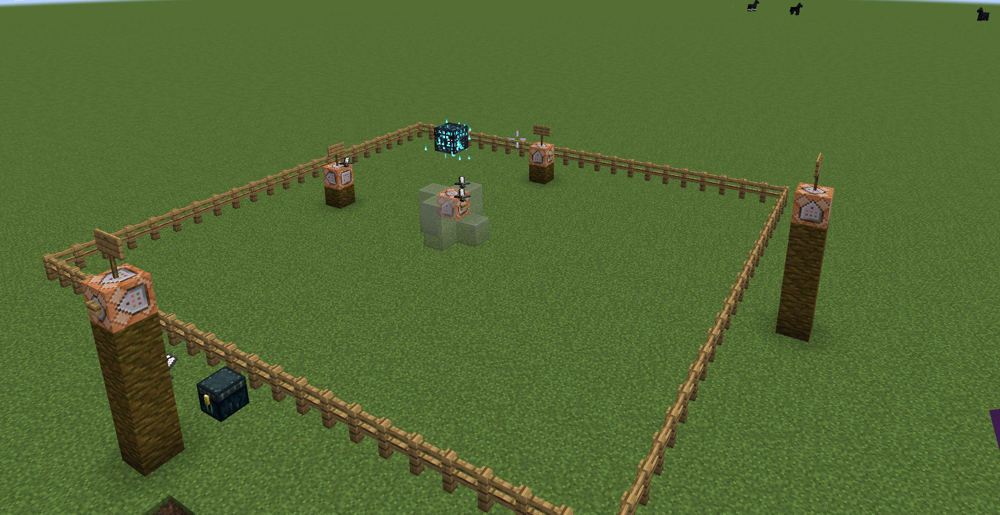

# 场地机制接口文档

## 系统概述

`area` 模块是一个**场地特殊机制的函数接口库**。这些函数可以被触发器、陷阱、机关或boss技能调用，为场景增添独特的战斗机制和视觉效果。每个功能都是独立的可调用接口，方便复用.这是一个独立的模块,你可以选择跳过不看,因为对整个数据包的框架了解没什么太大用处.

---

## 功能详解

## 🔮 紫水晶洞 (Amethyst Cave)

### 1. 区域发光 (Area Glow)

**功能描述：** 让调用位置周围10格内的所有敌人发光5秒

**调用方式：**
```mcfunction
execute positioned <X> <Y> <Z> run function area:amethyst_cave/area_glow
```

**执行逻辑：**
1. 检查10格内是否有敌人，无敌人则直接返回
2. 给范围内所有敌人添加：
   - `can_glow` 标签（用于其他系统识别）
   - `area_glow_mark` 标签（用于标记本次效果的对象）
   - 发光效果（5秒）
3. 播放音效和粒子特效
4. 5秒后自动移除标签

**相关文件：**

- `area_glow.mcfunction` - 主函数
- `remove_area_glow.mcfunction` - 5秒后自动移除标签
- `test_area_glow.mcfunction` - 测试函数

四个区域效果的命令方块如图所示,可以直接进存档看效果.(中间那个命令方块是召唤帅怪笼的)



---

### 2. 追踪炮弹 (Homing Bomb)

**功能描述：** 锁定20格内随机1个敌人发射追踪炮弹，击中后对3格范围内最多3个敌人造成30点真实伤害

**调用方式：**
```mcfunction
execute positioned <X> <Y> <Z> run function area:amethyst_cave/homing_bomb
```

**执行逻辑：**
1. 检查20格内是否有敌人，无敌人则直接返回
2. 随机选择1个敌人作为目标
3. 召唤光灵箭作为炮弹实体：
   - 无重力、发光
   - 速度 1.0 朝向目标
   - 寿命 120 tick (6秒)
   - 伤害值为0（伤害由爆炸函数处理）
4. 每tick执行 `homing_bomb_tick` 检测碰撞
5. 命中或超时后触发爆炸效果

**相关文件：**
- `homing_bomb.mcfunction` - 发射炮弹
- `homing_bomb_tick.mcfunction` - 炮弹移动和碰撞检测
- `homing_bomb_explosion.mcfunction` - 爆炸效果
- `test_homing_bomb.mcfunction` - 测试函数

这个追踪炮弹是给玩家的一个机关,可以绑定红石,让玩家可以利用机关来对付敌人.当时设想过给玩家一个高频脉冲的组件,比如比较器什么的,玩家可以用这个比较器来做一个高频,这样可以高速发射炮弹.

---

## 💧 水洞 (Water Cave)

### 水崩 (Water Burst)

**功能描述：** 创建一个持续12秒的腐蚀性水雾区域，范围内的敌人持续受到破防效果

**调用方式：**
```mcfunction
execute positioned <X> <Y> <Z> run function area:water_cave/summon_water_burst
```

**执行逻辑：**
1. 召唤marker实体作为区域中心
2. 设置存在时间为 240 tick (12秒)
3. 每tick执行 `water_burst_tick` 产生效果
4. 时间结束后自动消失

**持续效果（每tick）：**
- **破防效果：** 对8格内所有敌人施加破防buff（3秒持续时间）
  - 通过设置 `defense_reduce_duration` 分数为 60

**视觉特效布局：**
```
        北(~0,~0,~3)
          |
西北      |      东北
(~-2,~0,~2)    (~2,~0,~2)
          |
西--------●--------东
(~-3,~0,~0) (中心) (~3,~0,~0)
          |
西南      |      东南
(~-2,~0,~-2)   (~2,~0,~-2)
          |
        南(~0,~0,~-3)
```

**相关文件：**

- `summon_water_burst.mcfunction` - 召唤水崩区域
- `water_burst_tick.mcfunction` - 每tick效果处理

**应用场景：**

- 可以绑定到标靶方块，射中后触发(当时做这个时候就是这么设计的)
- Boss技能：在玩家位置召唤腐蚀区域

---

## 🕯️ 浮空墓地 (Floating Cemetery)

### 持灯悦灵 (Lantern Allay)

**功能描述：** 召唤一只特殊的悦灵，持续照亮周围8格内的敌人

**调用方式：**
```mcfunction
summon allay ~ ~ ~ {Tags:["hold_lantern"],CustomName:'{"text":"持灯悦灵","color":"aqua"}'}
scoreboard players set @e[tag=hold_lantern,limit=1,sort=nearest] temp2 0
```

**执行逻辑：**
- 悦灵需要添加 `hold_lantern` 标签
- 每tick自动执行 `lantern_allay_tick`
- 持续给周围8格敌人添加发光效果（2秒刷新）

**持续效果（每tick）：**
- **发光效果：** 8格内所有敌人获得发光（2秒）
- **标签添加：** 自动添加 `can_glow` 标签
- **粒子效果：** 每20tick在悦灵位置播放灵魂火焰粒子

**相关文件：**
- `lantern_allay_tick.mcfunction` - 悦灵tick函数
- `test_summon_lantern_allay.mcfunction` - 测试函数

**设计用途：**

当时做这个月灵的话,我想做一个场景,里面的所有怪都是隐身怪,然后玩家会利用技能或者跟随悦灵来照亮隐身的怪物,比如说可以搞个隐身的苦力怕来坑人什么的.

---

## 使用示例

### 示例1：机关触发区域发光
```mcfunction
# 当玩家踩到压力板时触发
execute as @a[distance=..2] at @s run function area:amethyst_cave/area_glow
```

### 示例2：Boss技能 - 发射炮弹
```mcfunction
# Boss每10秒发射一次追踪炮弹
execute as @e[tag=amethyst_boss] at @s if score @s skill_cooldown matches 0 run function area:amethyst_cave/homing_bomb
```

### 示例3：标靶触发水崩
```mcfunction
# 当标靶被射中时
execute as @e[type=minecraft:target,nbt={HitByProjectile:1b}] at @s run function area:water_cave/summon_water_burst
```

### 示例4：进入区域召唤悦灵
```mcfunction
# 当玩家进入浮空墓地区域时
execute as @a[tag=entered_cemetery,tag=!cemetery_allay_spawned] at @s run function area:floating_cemetery/test_summon_lantern_allay
tag @a[tag=entered_cemetery] add cemetery_allay_spawned
```

---

## 技术规范

### 实体标签约定

| 标签 | 用途 | 移除时机 |
|------|------|----------|
| `can_glow` | 标记可以发光的敌人 | 由其他系统管理 |
| `area_glow_mark` | 标记本次区域发光的目标 | 5秒后自动移除 |
| `scene_bomb_target` | 追踪炮弹的目标 | 发射后立即移除 |
| `scene_bomb_bullet` | 追踪炮弹子弹实体 | 爆炸或超时后移除 |
| `scene_bomb_explosion_target` | 爆炸范围内的敌人 | 伤害计算后立即移除 |
| `water_burst` | 水崩区域marker | 12秒后自动消失 |
| `hold_lantern` | 持灯悦灵 | 悦灵死亡时移除 |

### 计分板使用

| 分数 | 用途 |
|------|------|
| `temp` | 通用临时计时器（炮弹寿命、水崩持续时间等） |
| `temp2` | 悦灵粒子效果间隔计时器 |
| `defense_reduce_duration` | 破防效果持续时间 |

---

## 扩展建议

### 为新场地添加机制

1. 在 `data/area/functions/` 下创建新的场地文件夹
2. 遵循命名约定：`场地名_机制名.mcfunction`

