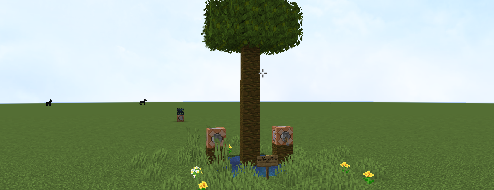
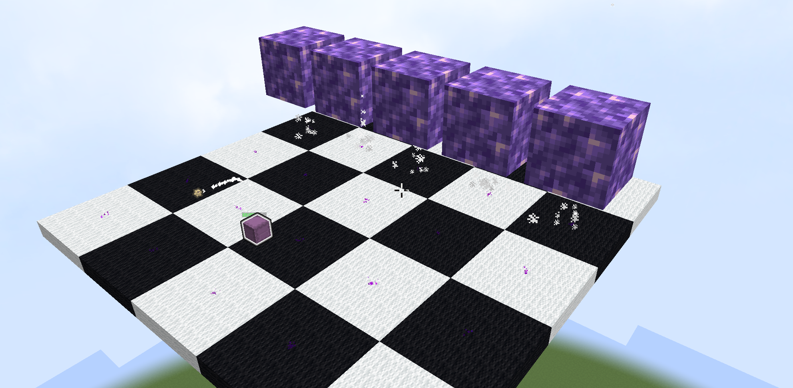
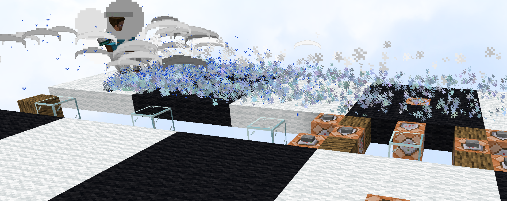
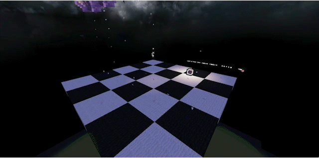
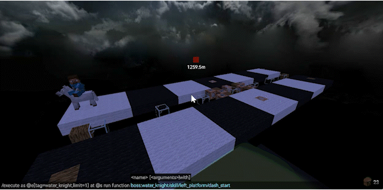

# Boss系统说明文档

## 系统概述

`boss` 模块是一个**测试性质的Boss战斗系统**。这些Boss并非完整的游戏内容，而是用于测试和验证战斗机制的原型。系统以**时序逻辑**为核心，通过阶段（Phase）切换和技能调度器来控制Boss行为。

---

## Boss列表

系统包含三个测试Boss

### 1. 💧 水滴骑士 (Water Knight)
### 2. 🔮 紫晶核心 (Amethyst Core)
### 3. ⚔️ 铁面教官 (Iron Instructor)
PS: 是因为这个 boss 其实还没做好,所以我没有把它移到测试存档,所以第三个“铁面教官”就不用管了.

boss通过这两个命令方块传送过去





水滴骑士没有做时序,只有命令方块实现逻辑的原型测试





---


## 通用系统架构

所有Boss都遵循统一的结构设计：

```
boss/<boss_name>/
├── main.mcfunction           # 主循环（每tick调用）
├── init.mcfunction            # 初始化Boss
├── phase_check.mcfunction     # 阶段检查和转换
├── update_bossbar.mcfunction  # 更新Boss血条
├── phase1/                    # 第一阶段
│   ├── phase1_main.mcfunction
│   └── random_skill.mcfunction
├── phase2/                    # 第二阶段
│   └── phase2_main.mcfunction
└── skill/                     # 技能函数库
    └── ...
```

### 核心执行流程

```
main.mcfunction (每tick)
    ├─ update_bossbar()      # 更新血条显示
    ├─ phase_check()         # 检查是否需要切换阶段
    ├─ phase1_main()         # 阶段1行为（条件执行）
    └─ phase2_main()         # 阶段2行为（条件执行）
```

---

## 特点

### 阶段系统
- 使用 `phase` 计分板分数标记当前阶段（1, 2, ...）
- 根据血量或特定条件触发阶段转换
- 不同阶段有独立的技能池和行为逻辑

### 时序控制
- 技能冷却通过计分板计时器管理
- 固定时序的技能释放（如棋盘格落下序列）

---

## 使用说明

### 初始化Boss
```mcfunction
/function boss:<boss_name>/init
```

### 手动测试技能
每个Boss的技能文件夹包含可独立测试的技能函数：
```mcfunction
/function boss:<boss_name>/skill/<skill_name>
```

---

## 开发目的

这些Boss主要用于：
- ✅ 测试战斗机制的可行性
- ✅ 验证时序系统的稳定性
- ✅ 开发技能效果原型

**注意：** 这不是完整的Boss内容，缺少平衡调整、完整的动画、对话系统等正式内容应有的元素。
