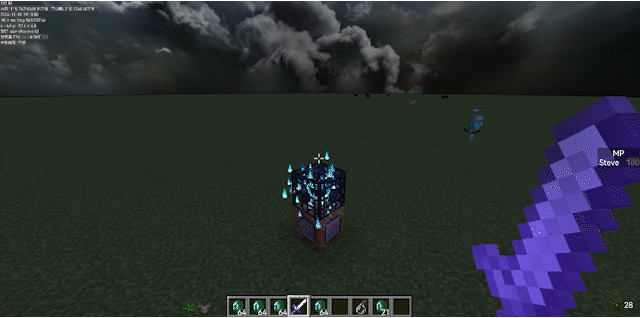
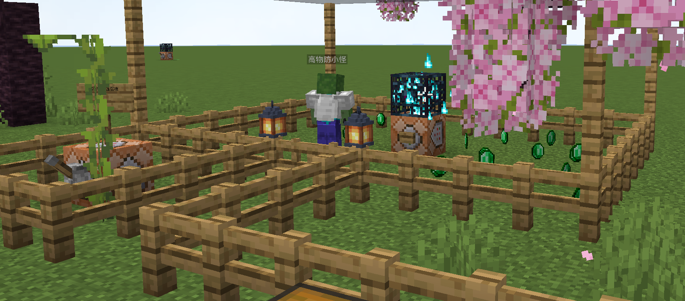
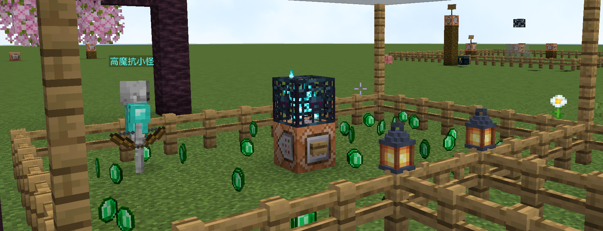

# 刷怪笼系统框架文档

---

## 📦 系统概述

自定义刷怪笼系统旨在**突破原版刷怪笼的各种限制条件**（如亮度要求、生物群系限制等），实现完全可控的怪物生成机制。



### 为什么不用原版刷怪笼？

原版刷怪笼受到多种限制：
- 🌙 **亮度限制** - 大多数怪物只能在黑暗环境刷新
- 🏔️ **生物群系限制** - 流浪者只在雪地刷新，溺尸只在海洋刷新
- 👥 **玩家距离限制** - 玩家太近或太远都不刷新
- 🎯 **刷新范围固定** - 无法自定义刷新范围

### 系统设计方案

本系统采用**双层结构**绕过所有原版限制：

#### 第一层：原版刷怪笼方块（底层）
- 🔧 **功能：** 纯视觉装饰，不实际刷怪（设置为无效生物）
- 🎮 **作用：** 可被玩家破坏，支持CTM地图"撸笼子"玩法

#### 第二层：item_display 实体（控制核心）
- 🎯 **功能1：** 作为刷怪笼的逻辑控制实体

- 📊 **管理：** 存储刷怪间隔、重试次数、进度等数据

- 🔄 **调度：** 执行刷怪循环和位置检测

  

- 🎨 **功能2：** 显示刷怪笼方块纹理，提供特效

- ⚡ **特效：** 根据刷怪进度动态显示粒子颜色和数量

  - 蓝色魂火（0-96%）→ 红色火焰（97-100%）
  - 粒子数量随进度递增（1→5个）

- 🧠 **核心：** 实际控制怪物生成逻辑

### 核心优势

✅ **完全自定义** - 无视任何原版限制条件  
✅ **动态视觉反馈** - 玩家可直观看到刷怪进度  
✅ **位置智能检测** - 简单递归防止怪物刷在方块里（探测1格）  
✅ **CTM友好** - 支持玩家破坏刷怪笼的玩法  
✅ **性能优化** - 动态调整刷怪频率，多个玩家在刷怪笼周围刷怪速度会变快.


如果你想看存档中的刷怪龙区域,那就是截图中的这两个地方.






---

## 🏗️ 系统架构

### 文件结构

```
enemy/functions/spawners/
├── 刷怪笼框架文档.md              # 本文档
├── common/                       # 通用框架函数
│   ├── spawn_manager.mcfunction         # 主管理器（注册所有刷怪笼）
│   ├── spawner_tick.mcfunction          # 通用刷怪笼逻辑框架（宏函数）
│   ├── detect_player.mcfunction         # 检测周围玩家数量
│   ├── update_interval.mcfunction       # 动态更新刷怪间隔
│   ├── particle_effect.mcfunction       # 动态粒子效果（宏函数）
│   ├── start_spawn_process.mcfunction   # 开始召唤流程（宏函数）
│   ├── generate_random_position.mcfunction  # 生成随机坐标偏移
│   ├── check_spawn_position.mcfunction     # 准备坐标数据
│   └── do_check_spawn.mcfunction          # 检测位置有效性并召唤
└── entities/                     # 实体召唤函数
    ├── test_sword_guard.mcfunction       # 测试剑卫
    └── test_shield_guard.mcfunction      # 测试盾卫
```

---

## 🔄 核心逻辑流程

### 主循环流程

```
spawn_manager.mcfunction (每tick执行)
    ↓
spawner_tick.mcfunction (通用框架)
    ├─ detect_player          # 检测玩家数量
    ├─ update_interval        # 更新刷怪间隔
    ├─ particle_effect        # 显示动态粒子（蓝→红渐变）
    └─ [间隔达到] start_spawn_process
            ↓
        generate_random_position  # 生成随机偏移坐标
            ↓
        check_spawn_position      # 转换数据格式
            ↓
        do_check_spawn           # 检测并召唤
            ├─ 检测目标位置（空气/水）
            ├─ [有效位置] → 召唤实体 ✅
            └─ [方块阻挡] → 重试（最多20次，简单递归防卡墙）
```

### 位置检测机制

系统实现了**简单递归检测**防止怪物刷在方块里：

1. **生成随机坐标** - 在指定范围内随机生成偏移量
2. **检测目标位置** - 检查目标位置是否为空气或水（目前探测1格）
   - ✅ 空气方块 → 可以刷新
   - ✅ 水方块 → 可以刷新（支持水生生物）
   - ❌ 固体方块 → 位置无效，重新生成
3. **重试机制** - 最多尝试20次寻找有效位置
4. **安全退出** - 超过20次失败则放弃本次刷新

**注意：** 目前只检测目标位置本身（1格），未检测头部空间。如果需要刷新高大生物（如末影人），建议增加Y轴检测范围。

---

## 📚 通用框架函数说明

系统包含9个核心函数，详细说明请查看各函数文件内的注释：

| 函数名 | 类型 | 主要功能 |
|-------|------|---------|
| `spawn_manager.mcfunction` | 主循环 | 注册所有刷怪笼，管理生命周期 |
| `spawner_tick.mcfunction` | 宏函数 | 通用逻辑框架（检测→更新→粒子→召唤） |
| `detect_player.mcfunction` | 工具函数 | 检测15格内玩家数量 |
| `update_interval.mcfunction` | 工具函数 | 根据玩家数量动态调整速率 |
| `particle_effect.mcfunction` | 宏函数 | 基于百分比的动态粒子效果 |
| `start_spawn_process.mcfunction` | 宏函数 | 初始化召唤流程（性能优化） |
| `generate_random_position.mcfunction` | 宏函数 | 生成随机坐标偏移 |
| `check_spawn_position.mcfunction` | 工具函数 | 转换数据格式（计分板→storage） |
| `do_check_spawn.mcfunction` | 宏函数 | 检测位置有效性并召唤 |

---

## 🎮 如何添加新刷怪笼

### 步骤1: 创建实体召唤函数

**文件路径**: `enemy/functions/spawners/entities/your_entity.mcfunction`

**示例**:
```mcfunction
# 召唤森林僵尸
summon minecraft:zombie ~ ~1 ~ {
    CustomName:"[\"§2森林僵尸\"]",
    CustomNameVisible:1b,
    Health:300f,
    Tags:["enemy","forest_mob","summon"],
    Attributes:[
        {Base:300,Name:"generic.max_health"},
        {Base:5d,Name:"generic.attack_damage"}
    ]
}

# 设置自定义属性
scoreboard players set @e[tag=summon] max_health 300
scoreboard players set @e[tag=summon] current_health 300
scoreboard players set @e[tag=summon] physical_armor 15
scoreboard players set @e[tag=summon] magic_resist 5

# 计算护甲类型
scoreboard players operation @e[tag=summon,limit=1] last_health = @e[tag=summon,limit=1] max_health
execute as @e[tag=summon,limit=1] run function combat:healthbar/calculate_armor_type
scoreboard players set @e[tag=summon] hit_cooldown 0

# 加入敌对队伍
team join red @e[tag=summon]

# 给予效果
effect give @e[tag=summon] minecraft:resistance 1 4 true
effect give @e[tag=summon] fire_resistance infinite 4 true

# 清除召唤标签
tag @e remove summon
```

---

### 步骤2: 在 `spawn_manager.mcfunction` 注册

**添加一行代码**:
```mcfunction
# 森林僵尸刷怪笼（X/Z轴±5格，Y轴±2格随机召唤）
execute as @e[type=item_display,tag=forest_zombie_spawner] at @s run function enemy:spawners/common/spawner_tick {
    "summon_entity":"enemy:spawners/entities/your_entity",
    "interval":400,
    "range_x":"5",
    "range_y":"2",
    "range_z":"5"
}
```

**参数说明**:
- `summon_entity` - 实体召唤函数路径
- `interval` - 刷怪间隔（tick，20tick=1秒）
- `range_x/y/z` - 随机召唤范围（±格数）

---

### 步骤3: 在游戏中放置刷怪笼

**在对应位置放置刷怪笼方块,用于提供给玩家视觉上的挖掘效果**

**召唤 item_display**:

```mcfunction
/summon item_display ~ ~ ~ {Tags:["spawner","forest_zombie_spawner"]}
```

**完成！** 刷怪笼会自动开始工作。
