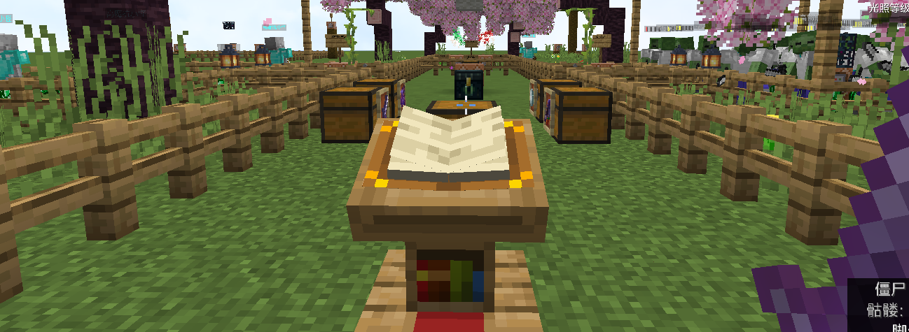
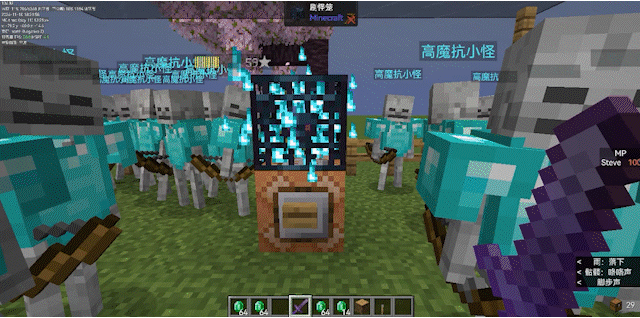
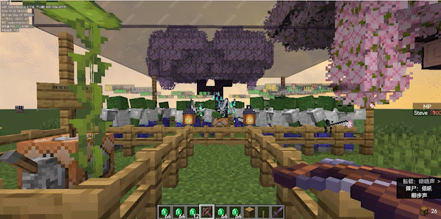
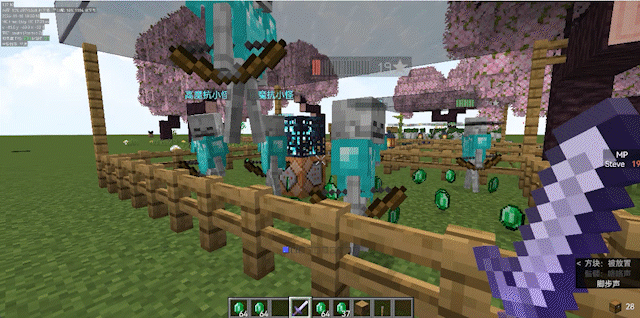
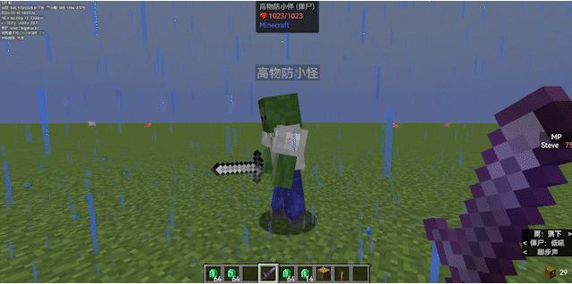
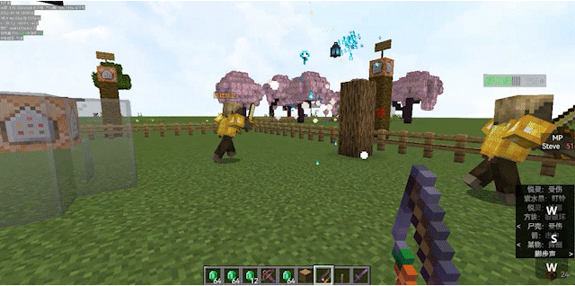

# 技能系统调用链文档 (Skill System Call Chain)

---

## 系统概述

**技能系统**是一个支持多武器、多玩家、多技能的战斗技能框架。玩家可以通过**末影箱技能槽位**装备技能，使用**潜行+操作**的组合键触发技能。

### 核心特性

- 🎮 **三大武器系统** - 剑、弩、法杖，每种武器3个技能槽位
- 🎯 **9技能槽位** - 每个玩家可装备9个技能（3武器 × 3槽位）
- 🔄 **多人数据隔离** - 每个玩家的技能CD、MP独立管理
- 🎪 **组合键触发** - 潜行+左键/跳跃/右键释放技能
- 📦 **末影箱管理** - 通过末影箱装备和切换技能
- ⏱️ **统一CD管理** - 所有技能CD集中管理和递减

存档中技能的使用场景如下,你可以在这里来游玩测试.














---

## 核心架构

### 文件结构

```
skill/functions/
├── check_all_skills.mcfunction       # 统一技能检测（Buff、子弹碰撞等）
├── manage_skill_slots.mcfunction     # 技能槽位占位符管理
├── cd/
│   ├── manager.mcfunction            # CD递减管理器
│   └── reduce.mcfunction             # CD递减宏函数
├── trigger/
│   ├── sword_skill_trigger_1/2/3.mcfunction    # 剑技能触发器
│   ├── bow_skill_trigger_1/2/3.mcfunction      # 弩技能触发器
│   └── stick_skill_trigger_1/2/3.mcfunction    # 杖技能触发器
├── sword_skill/                      # 剑系技能
├── bow_skill/                        # 弩系技能
├── stick_skill/                      # 杖系技能
└── other_skill/                      # 通用技能
```

---

## 完整调用链

### 主循环执行流程

```
z_loop:player_manager (每tick)
    ↓
player:player_common {"id":"X"} (每个玩家)
    ↓
    ├─ [检测潜行] player:shift {"player":"player_X"}
    │       ↓
    │   [检测武器类型和操作]
    │       ↓
    │   skill:trigger/<武器>_skill_trigger_<1/2/3>
    │       ↓
    │   [检测末影箱槽位]
    │       ↓
    │   skill:<类型>/<技能名>/<技能名>.mcfunction
    │       ↓
    │   ├─ MP检查 (不足 → 提示 → return)
    │   ├─ CD检查 (未冷却 → 提示 → return)
    │   ├─ 消耗MP
    │   ├─ 设置CD
    │   ├─ 执行技能效果
    │   │   └─ [子弹类技能] 召唤子弹实体
    │   └─ 视觉反馈（音效、粒子）
    │
    └─ [统一检测] skill:check_all_skills {"id":"X"}
            ↓
        ├─ 子弹碰撞检测
        ├─ Buff持续效果
        ├─ 实体管理（技能召唤物）
        └─ 延迟触发检测

z_loop:player_manager (每tick)
    ↓
skill:cd/manager (CD管理器)
    ↓
    └─ 所有技能CD递减 (CD > 0 → CD--)

z_loop:player_manager (每tick)
    ↓
skill:manage_skill_slots (每tick)
    ↓
    └─ 清理背包占位符，刷新末影箱空槽位
```

---

## 三大武器系统

### 剑系技能（Sword Skills）

**武器识别：**

- `minecraft:iron_sword` - 单手剑
- `minecraft:netherite_sword` - 刺剑

**技能槽位：**
- 槽位 18 - 剑技能1（潜行+左键）
- 槽位 19 - 剑技能2（潜行+跳跃）
- 槽位 20 - 剑技能3（潜行+右键）

**调用链：**
```
player:shift
    ↓
检测：持有铁剑/下界合金剑 + 潜行 + 左键
    ↓
skill:trigger/sword_skill_trigger_1
    ↓
根据player_1/2/3标签分流
    ↓
skill:trigger/sword_skill_trigger_1_p1/p2/p3
    ↓
检测末影箱槽位18：{Slot:18b,tag:{skill_id:"XXX"}}
    ↓
skill:sword_skill/<技能名>/<技能名>.mcfunction
```

**特点：**
- ⚠️ **硬编码storage** - 剑技能使用独立的p1/p2/p3函数（历史遗留,有一次重构,我不知道为什么就导致了这个bug,剑的它这个展开宏函数必须必须硬编码几个,我当时折腾了蛮久也没搞好这个东西,排查太累了,干脆就直接硬编码了）
- 每个玩家有独立的触发器文件

---

### 弩系技能（Bow Skills）

**武器识别：**
- `minecraft:crossbow` - 弩

**技能槽位：**
- 槽位 21 - 弩技能1（潜行+左键）
- 槽位 22 - 弩技能2（潜行+跳跃）
- 槽位 23 - 弩技能3（潜行+右键）

**调用链：**
```
player:shift {"player":"player_X"}
    ↓
检测：持有弩 + 潜行 + 左键
    ↓
skill:trigger/bow_skill_trigger_1 with storage damage:player_X
    ↓
检测末影箱槽位21：{Slot:21b,tag:{skill_id:"XXX"}}
    ↓
skill:bow_skill/<技能名>/<技能名>.mcfunction with storage damage:player_X
```

**特点：**
- ✅ **使用宏函数** - 动态传递玩家storage参数
- 统一的触发器，通过宏参数处理多玩家

---

### 杖系技能（Stick Skills）

**武器识别：**

- `minecraft:carrot_on_a_stick` - 散杖
- `minecraft:warped_fungus_on_a_stick` - 凝杖

**技能槽位：**
- 槽位 24 - 杖技能1（潜行+左键）
- 槽位 25 - 杖技能2（潜行+跳跃）
- 槽位 26 - 杖技能3（潜行+右键）

**调用链：**
```
player:shift {"player":"player_X"}
    ↓
检测：持有散杖/凝杖 + 潜行 + 左键
    ↓
skill:trigger/stick_skill_trigger_1 with storage damage:player_X
    ↓
检测末影箱槽位24：{Slot:24b,tag:{skill_id:"XXX"}}
    ↓
skill:stick_skill/<技能名>/<技能名>.mcfunction with storage damage:player_X
```

**特点：**
- ✅ **使用宏函数** - 动态传递玩家storage参数
- 支持两种法杖类型

**示例技能：**
- 点火、弱化弹、旋风、天降甘露、火焰喷射、暗影法阵、魂灵爆破、漂泊之灯

---

## 技能槽位系统

### 末影箱槽位分配

```
末影箱布局（27槽位）：
┌────────────────────────────────────┐
│ 0   1   2   3   4   5   6   7   8  │ 第1行
│ 9   10  11  12  13  14  15  16  17 │ 第2行
│[18][19][20][21][22][23][24][25][26]│ 第3行 ← 技能槽位
└────────────────────────────────────┘

技能槽位：
[18] 剑技能1 - 潜行+左键
[19] 剑技能2 - 潜行+跳跃
[20] 剑技能3 - 潜行+右键

[21] 弩技能1 - 潜行+左键
[22] 弩技能2 - 潜行+跳跃
[23] 弩技能3 - 潜行+右键

[24] 杖技能1 - 潜行+左键
[25] 杖技能2 - 潜行+跳跃
[26] 杖技能3 - 潜行+右键
```

### 占位符系统

**功能：** 为空的技能槽位自动放置彩色玻璃板占位符

**实现：** `skill:manage_skill_slots` (每tick执行)

```mcfunction
# 1. 清除背包中的占位符（防止玩家拿出来）
clear @a red_stained_glass_pane{skill_placeholder:1b}
clear @a cyan_stained_glass_pane{skill_placeholder:1b}
clear @a purple_stained_glass_pane{skill_placeholder:1b}

# 2. 检测空槽位，放置占位符
# 槽位18 - 剑技能1
execute as @a unless data entity @s EnderItems[{Slot:18b}] run item replace entity @s enderchest.18 with red_stained_glass_pane{...}

# 槽位21 - 弩技能1
execute as @a unless data entity @s EnderItems[{Slot:21b}] run item replace entity @s enderchest.21 with cyan_stained_glass_pane{...}

# 槽位24 - 杖技能1
execute as @a unless data entity @s EnderItems[{Slot:24b}] run item replace entity @s enderchest.24 with purple_stained_glass_pane{...}
```

**颜色分类：**
- 🔴 红色玻璃板 - 剑技能槽位
- 🔵 青色玻璃板 - 弩技能槽位
- 🟣 紫色玻璃板 - 杖技能槽位

---

## 数据流追踪

### 案例1：玩家1释放"三连斩"技能

```
[第N tick] 玩家按下Shift + 左键
    ↓
player:player_common {"id":"1"}
    检测到：put_shift=1 (潜行)
    ↓
player:shift {"player":"player_1"}
    检测到：left_click标签 + 持有铁剑
    ↓
skill:trigger/sword_skill_trigger_1
    检测到：玩家有player_1标签
    ↓
skill:trigger/sword_skill_trigger_1_p1
    检测到：末影箱槽位18有{skill_id:"三连斩"}
    ↓
skill:sword_skill/triple_slash/triple_slash with storage damage:player_1
    ├─ 检查MP：需要10MP
    │   └─ MP不足 → 提示 → return
    ├─ 检查CD：triple_slash_CD
    │   └─ CD未冷却 → 提示剩余秒数 → return
    ├─ 消耗MP：MP -= 10
    ├─ 设置CD：triple_slash_CD = 40 (2秒)
    ├─ 标记目标：前方4格内的敌人 → tag lock
    ├─ 视觉效果：粒子 + 音效
    └─ 触发伤害：通过三连斩的特殊检测系统

[后续每tick]
skill:cd/manager
    └─ triple_slash_CD-- (40→39→38...→0)

skill:check_all_skills {"id":"1"}
    └─ 检测三连斩连击次数（如果需要）
```

---

### 案例2：玩家2释放"点火"技能（子弹类）

```
[第N tick] 玩家按下Shift + 左键
    ↓
player:shift {"player":"player_2"}
    检测到：left_click标签 + 持有散杖
    ↓
skill:trigger/stick_skill_trigger_1 with storage damage:player_2
    检测到：末影箱槽位24有{skill_id:"点火"}
    ↓
skill:stick_skill/ignite/ignite with storage damage:player_2
    ├─ MP/CD检查
    ├─ 消耗MP，设置CD
    ├─ 召唤光灵箭
    │   └─ 添加标签：ignite_bullet_player_2
    ├─ 计算飞行方向（临时marker）
    └─ 视觉效果

[后续每tick]
skill:check_all_skills {"id":"2"}
    └─ execute as @e[tag=ignite_bullet_player_2] at @s run function skill:stick_skill/ignite/ignite_tick
        ├─ 显示粒子轨迹
        ├─ 寿命递减（temp--）
        └─ 碰撞检测
            └─ [命中敌人] skill:stick_skill/ignite/ignite_explosion
                ├─ 标记范围内敌人
                ├─ 施加燃烧效果
                ├─ 爆炸粒子
                └─ kill子弹

skill:cd/manager
    └─ ignite_CD-- (递减)
```

---

### 案例3：CD管理器工作流程

```
[每tick]
z_loop:player_manager
    ↓
skill:cd/manager
    ↓
    ├─ function skill:cd/reduce {cd:"triple_slash_CD"}
    │       └─ execute as @a if score @s triple_slash_CD matches 1.. run scoreboard players remove @s triple_slash_CD 1
    │
    ├─ function skill:cd/reduce {cd:"snipe_CD"}
    │       └─ execute as @a if score @s snipe_CD matches 1.. run scoreboard players remove @s snipe_CD 1
    │
    ├─ function skill:cd/reduce {cd:"ignite_CD"}
    │       └─ execute as @a if score @s ignite_CD matches 1.. run scoreboard players remove @s ignite_CD 1
    │
    └─ ... (所有技能CD递减)

    ├─ execute as @a if score @s MP >= @s max_MP run scoreboard players operation @s MP = @s max_MP
    └─ (限制MP不超过上限)
```

---

## 设计理念

### 1. 组合键触发机制

**实现方式：**

```
潜行（Shift） + 操作
    ├─ 左键（left_click标签）
    ├─ 跳跃（jump分数）
    └─ 右键（right_click标签）
```

#### 按键检测技术实现

系统使用**交互实体（interaction）**实现左键/右键检测：

```mcfunction
# 在玩家眼前固定距离放置一个不可见的交互实体
summon interaction ~ ~1.5 ~ {
    Tags:["player_interaction"],
    width:0.1f,
    height:0.1f,
    response:true
}

# 每tick将交互实体传送到玩家眼前
execute as @a at @s anchored eyes run tp @e[tag=player_interaction,limit=1] ^ ^ ^0.5
```

**检测原理：**
1. **左键检测** - 玩家左键点击交互实体时，记录attack数据
   ```mcfunction
   # 检测interaction的attack数据
   execute as @e[type=interaction,nbt={attack:{}}] run tag @a[distance=..2] add left_click
   ```

2. **右键检测** - 玩家右键点击交互实体时，记录interaction数据
   ```mcfunction
   # 检测interaction的interaction数据
   execute as @e[type=interaction,nbt={interaction:{}}] run tag @a[distance=..2] add right_click
   ```

3. **跳跃检测** - 通过minecraft.custom:minecraft.jump统计项
   ```mcfunction
   scoreboard players set @a jump 0
   execute as @a[scores={jump_stat=1..}] run scoreboard players set @s jump 1
   scoreboard players set @a jump_stat 0
   ```

---

### 2. 末影箱技能管理

**设计目的：** 使用末影箱作为技能装备界面

**原因：**
- 📦 末影箱数据持久化（不会掉落）

**技能物品格式：**
```mcfunction
# 技能书示例
give @s written_book{
    skill_id:"三连斩",
    display:{
        Name:'{"text":"三连斩","color":"red"}',
        Lore:[
            '{"text":"快速挥剑三次","color":"gray"}',
            '{"text":"消耗：10MP","color":"aqua"}',
            '{"text":"冷却：2秒","color":"yellow"}'
        ]
    }
}
```

---

### 3. 多玩家数据隔离

**问题：** 多个玩家同时使用技能会互相干扰

**解决方案：**

#### A. 剑技能（历史遗留）
使用**硬编码的玩家专用函数**：
```
sword_skill_trigger_1
    ↓
├─ sword_skill_trigger_1_p1 (with storage damage:player_1)
├─ sword_skill_trigger_1_p2 (with storage damage:player_2)
└─ sword_skill_trigger_1_p3 (with storage damage:player_3)
```

#### B. 弩/杖技能（推荐）
使用**宏函数动态传递**：
```mcfunction
$execute as @a[tag=$(player),nbt={SelectedItem:{id:"minecraft:crossbow"}}] at @s run function skill:trigger/bow_skill_trigger_1 with storage damage:$(player)

# 展开为：
# with storage damage:player_1
# with storage damage:player_2
# with storage damage:player_3
```

#### C. 子弹实体隔离
使用**玩家ID标签**：
```mcfunction
# 召唤时添加玩家标签
$tag @e[tag=summon] add ignite_bullet_player_$(id)

# 检测时按玩家分别处理
$execute as @e[tag=ignite_bullet_player_$(id)] at @s run function skill:stick_skill/ignite/ignite_tick
```

---

### 4. 统一检测框架

**设计目的：** 集中管理所有需要每tick检测的技能效果

**check_all_skills 负责：**

- 🔫 子弹碰撞检测
- 💨 Buff持续效果（如旋风斩、剑舞）
- 🏛️ 技能召唤物管理（如决斗领域、暗影法阵）
- ⏰ 延迟触发检测（如三连斩连击）

---

### 5. CD递减集中管理

**设计目的：** 所有技能CD在一个地方统一递减

**cd/manager.mcfunction：**

```mcfunction
# 所有技能CD递减
function skill:cd/reduce {cd:"triple_slash_CD"}
function skill:cd/reduce {cd:"snipe_CD"}
function skill:cd/reduce {cd:"ignite_CD"}
...
```

**cd/reduce.mcfunction（宏函数）：**
```mcfunction
$execute as @a if score @s $(cd) matches 1.. run scoreboard players remove @s $(cd) 1
```

**优势：**
- ✅ 一行代码管理一个CD
- ✅ 使用宏函数减少重复代码
- ✅ 新增技能只需添加一行

---

## 技能类型分类

### 即时生效技能

**特点：** 释放后立即生效，无延迟

**示例：** 紫晶高亮、炎爆术、圣盾

**调用链：**
```
技能函数
    ↓
MP/CD检查 → 消耗MP → 设置CD → 立即执行效果 → 视觉反馈
```

---

### 延迟生效技能

**特点：** 使用schedule延迟N秒执行

**示例：** 重斩（延迟3秒造成400%伤害）

**调用链：**
```
技能函数
    ↓
MP/CD检查 → 消耗MP → 设置CD → 标记目标 → schedule延迟执行
    ↓ (N秒后)
延迟执行函数
    ↓
检查目标存在 → 执行效果 → 清理标签
```

**注意：** 需要为每个玩家创建独立的execute函数

---

### 子弹技能

**特点：** 召唤子弹实体，每tick检测碰撞

**示例：** 点火、狙击、凝滞弹、加农炮

**调用链：**
```
技能函数
    ↓
MP/CD检查 → 消耗MP → 设置CD → 召唤光灵箭 → 添加玩家ID标签 → 计算飞行方向
    ↓ (每tick)
check_all_skills
    ↓
子弹tick函数
    ↓
粒子轨迹 → 寿命递减 → 碰撞检测 → [命中] 爆炸/伤害 → kill子弹
```

---

### Buff/持续效果技能

**特点：** 给玩家/敌人添加持续效果

**示例：** 旋风斩、剑舞、火焰喷射、天降甘露

**调用链：**

```
技能函数
    ↓
MP/CD检查 → 消耗MP → 设置CD → 添加Buff标签/分数
    ↓ (每tick)
check_all_skills
    ↓
Buff tick函数
    ↓
检测Buff状态 → 执行效果 → Buff计时递减 → [超时] 清除Buff
```

---

### 召唤物技能

**特点：** 召唤持续存在的实体（marker、display等）

**示例：** 决斗领域、暗影法阵、漂泊之灯

**调用链：**

```
技能函数
    ↓
MP/CD检查 → 消耗MP → 设置CD → 召唤marker/display → 设置寿命
    ↓ (每tick)
check_all_skills
    ↓
召唤物tick函数
    ↓
范围检测 → 应用效果 → 粒子显示 → 寿命递减 → [超时] kill实体
```
