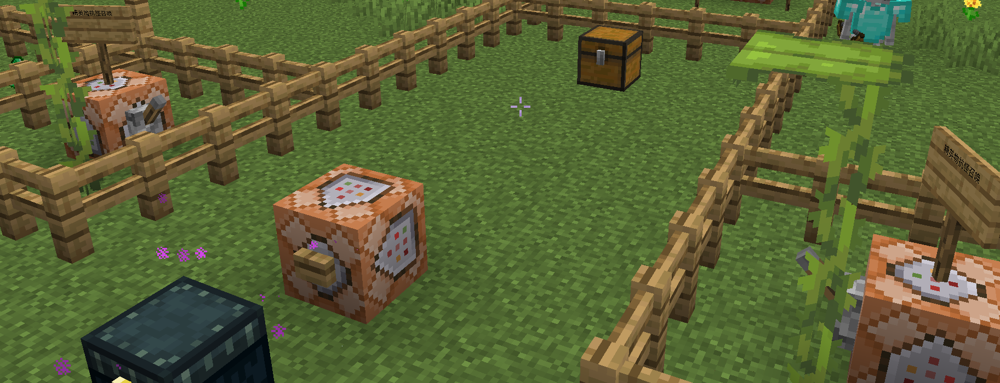

# 灵魂光盘系统 (Soul Disc System)

---

## 系统概述

**灵魂光盘**（Soul Disc，简称"魂盘"）是一个被动增益系统，玩家可以装备多个魂盘获得永久被动效果。

### 核心特性

- 🎵 **物品形式**: 使用音乐唱片（music_disc）作为载体
- 🎒 **装备方式**: 放入背包即可生效
- 📊 **容量限制**: 玩家有魂槽容量限制（`max_soul_disc`），超载会导致所有魂盘失效
- 🔄 **实时检测**: 每tick检测玩家背包中的魂盘并触发对应效果
- 🏷️ **标识系统**: 使用 `sd_id` NBT标签区分不同魂盘

**分散实现:** 魂盘实现确实分散在各处，不只在 soul_disc 模块

实现方式差异:

 \- 独立效果型：在 soul_manager.mcfunction 注册

 \- 武器修改型：在 player_common.mcfunction 中检测，分叉调用不同函数

 - 伤害计算公式影响型:在combat模块内检测调用

所有的魂盘都被放在了图中所示的箱子里.欢迎使用!



---

## 核心机制

### 1. 魂盘检测流程

```
player_common.mcfunction (每tick)
    ↓
soul_manager.mcfunction (宏函数，传入玩家ID)
    ↓
├─ 统计背包中的音乐唱片数量 → soul_disc记分板
├─ 检查是否超载 (soul_disc > max_soul_disc)
│   ├─ 超载 → 调用 overload.mcfunction → 提示玩家 → 添加overload标签 → 中止
│   └─ 未超载 → 移除overload标签 → 继续
└─ 检测背包中的魂盘NBT (sd_id) → 调用对应的魂盘效果函数
```

### 2. 超载机制

当玩家装备的魂盘数量超过 `max_soul_disc` 时：
- 显示警告提示：`§4『你的魂槽无法容纳那么多魂盘,所有魂盘会失效,尝试下调几个魂盘吧!』`
- 添加 `overload` 标签
- **所有魂盘效果失效**，直到玩家移除多余的魂盘

### 3. 魂盘识别

使用NBT标签识别：
```json
{
    from_map: 1b,
    soul_disc: 1b,
    sd_id: "魂盘名称"
}
```

检测方式：
```mcfunction
execute if entity @s[nbt={Inventory:[{tag:{sd_id:"魂盘名称"}}]}] run function soul_disc:sd_functions/xxx
```

---

## 函数调用结构

### 📂 文件结构

```
soul_disc/functions/
├── soul_manager.mcfunction        # 主管理器（宏函数）
├── overload.mcfunction            # 超载处理
└── sd_functions/                  # 魂盘效果函数
    ├── wn.mcfunction             # 亡者之怒
    ├── lh.mcfunction             # 烈火焚心
    ├── lhfs.mcfunction           # 烈火焚身
    ├── lhfs_trigger.mcfunction   # 烈火焚身触发
    ├── lhfs_burn.mcfunction      # 烈火焚身燃烧应用
    ├── lhgy.mcfunction           # 灵魂共鸣
    ├── zdxh.mcfunction           # 战斗续航
    ├── zdxh_check_kill.mcfunction # 战斗续航击杀检测
    ├── zdxh_heal.mcfunction      # 战斗续航回复
    ├── four.mcfunction           # 厄运数字4
```

---

## 函数详解

### 1. soul_manager.mcfunction

**路径**: `soul_disc/functions/soul_manager.mcfunction`  
**类型**: 宏函数  
**调用位置**: `player/functions/player_common.mcfunction`  
**执行者**: 玩家

**调用方式**:
```mcfunction
$execute at @s run function soul_disc:soul_manager with storage damage:player_$(id)
```

**功能流程**:

```mcfunction
# 1. 统计背包中的音乐唱片数量
execute store result score @s soul_disc run clear @s #music_discs 0

# 2. 检查是否超载
execute if score @s soul_disc > @s max_soul_disc run function soul_disc:overload
execute if score @s soul_disc > @s max_soul_disc run return 2

# 3. 移除超载标签（未超载时）
tag @s remove overload

# 4. 检测并触发各个魂盘效果
execute if entity @s[nbt={Inventory:[{tag:{sd_id:"亡者之怒"}}]}] run function soul_disc:sd_functions/wn
execute if entity @s[nbt={Inventory:[{tag:{sd_id:"烈火焚心"}}]}] run function soul_disc:sd_functions/lh
execute if entity @s[nbt={Inventory:[{tag:{sd_id:"烈火焚身"}}]}] run function soul_disc:sd_functions/lhfs
execute if entity @s[nbt={Inventory:[{tag:{sd_id:"灵魂共鸣"}}]}] run function soul_disc:sd_functions/lhgy
execute if entity @s[nbt={Inventory:[{tag:{sd_id:"战斗续航"}}]}] run function soul_disc:sd_functions/zdxh
$execute if entity @s[nbt={Inventory:[{tag:{sd_id:"厄运数字4"}}]}] run execute as @e[tag=enemy,distance=..10] run function soul_disc:sd_functions/four with storage damage:$(player)
```

**关键点**:
- 使用 `clear @s #music_discs 0` 统计但不删除音乐唱片
- 超载时立即中止，不执行任何魂盘效果
- 每个魂盘独立检测和执行

---

### 2. overload.mcfunction

**路径**: `soul_disc/functions/overload.mcfunction`  
**执行者**: 玩家

**功能**:
```mcfunction
title @s actionbar "§4『你的魂槽无法容纳那么多魂盘,所有魂盘会失效,尝试下调几个魂盘吧!』"
tag @s add overload
```

提示玩家超载并添加标签。

---

## 已实现的魂盘

### 1. 亡者之怒 (wn)

**文件**: `sd_functions/wn.mcfunction`

**效果**: 当血量低于20%时，攻击力+4，移动速度+20%

**实现逻辑**:
```mcfunction
# 计算20%最大生命值
execute store result score #temp temp1 run attribute @s generic.max_health get 0.2

# 如果当前HP <= 20%最大HP，给予速度效果
execute if score @s HP <= #temp temp1 run effect give @s speed 1 0 true
execute if score @s HP <= #temp temp1 run scoreboard players set @s wn_buff 1

# 如果血量大于等于20%，清除buff标记
execute if score @s HP > #temp temp1 run scoreboard players set @s wn_buff 0
```

---

### 3. 烈火焚身 (lhfs)

**文件**: `sd_functions/lhfs.mcfunction`, `lhfs_trigger.mcfunction`, `lhfs_burn.mcfunction`

**效果**: 靠近玩家5格的敌人每秒叠加1.5秒燃烧时间

**实现逻辑**:
```mcfunction
# lhfs.mcfunction - 主逻辑
# 计时器递增
scoreboard players add @s lhfs_timer 1

# 每20tick（1秒）触发一次
execute if score @s lhfs_timer matches 20.. run function soul_disc:sd_functions/lhfs_trigger

# 重置计时器
execute if score @s lhfs_timer matches 20.. run scoreboard players set @s lhfs_timer 0
```

---

### 4. 灵魂共鸣 (lhgy)

有的魂盘函数里写的名字和实际的不太一样,这是因为我最早取了名,后来又改了名字,造成的一个`历史遗留问题吧.

**文件**: `sd_functions/lhgy.mcfunction`

**效果**: 每5秒自动回复10 MP

**实现逻辑**:

```mcfunction
# 计时器递增
scoreboard players add @s lhgy_timer 1

# 每100tick（5秒）触发一次
execute if score @s lhgy_timer matches 100.. run scoreboard players add @s MP 100

# 触发时的视觉和音效反馈
execute if score @s lhgy_timer matches 100.. run particle soul ~ ~1 ~ 0.3 0.5 0.3 0.02 10 force
execute if score @s lhgy_timer matches 100.. run particle enchant ~ ~1 ~ 0.5 0.5 0.5 0.1 15 force
execute if score @s lhgy_timer matches 100.. run playsound block.enchantment_table.use player @s ~ ~ ~ 0.5 1.5

# 重置计时器
execute if score @s lhgy_timer matches 100.. run scoreboard players set @s lhgy_timer 0
```

---

### 5. 战斗续航 (zdxh)

**文件**: `sd_functions/zdxh.mcfunction`, `zdxh_check_kill.mcfunction`, `zdxh_heal.mcfunction`

**效果**: 血量低于50%时，击杀敌人会回复自身4点生命值，有2秒冷却时间

**实现逻辑**:

```mcfunction
# 设置can_be_effect计分板，允许接受buff（2 tick）
scoreboard players set @s can_be_effect 2

# 使用effect指令实际治疗玩家
effect give @s minecraft:instant_health 1 0 true

# 设置3.5秒冷却（70 tick）
scoreboard players set @s zdxh_cd 70

# 视觉和音效反馈
particle heart ~ ~1 ~ 0.5 0.5 0.5 0.1 5 force
particle happy_villager ~ ~1 ~ 0.3 0.3 0.3 0 10 force
playsound entity.player.levelup player @s ~ ~ ~ 0.5 2
title @s actionbar {"text":"战斗续航 - 回复生命值！","color":"green","bold":true}

# 如果当前生命值<=50%最大生命值，且CD已结束
execute if score @s HP <= #zdxh_hp temp if score @s zdxh_cd matches ..0 run function soul_disc:sd_functions/zdxh_check_kill
```

```mcfunction
# zdxh_check_kill.mcfunction - 击杀检测
# 使用 total_kill_count 统一检测所有击杀
# 如果击杀数 > 0，说明击杀了敌人
execute if score @s total_kill_count matches 1.. run function soul_disc:zdxh/zdxh_heal
```

---

### 6. 厄运数字4 (four)

**文件**: `sd_functions/four.mcfunction`

**效果**: 周围10格半径内HP末尾数字为4的敌人（如24/54/64等）受到44%的真实伤害

**实现逻辑**:
```mcfunction
# 获取敌人自定义血量系统的当前生命值
scoreboard players operation @s hp_temp = @s current_health
scoreboard players set #temp hp_temp 10
scoreboard players operation @s hp_temp %= #temp hp_temp
# 如果个位数是4，造成44%真实伤害
$execute if score @s hp_temp matches 4 run function combat:deal/damage_deal {"rate":"44","type":"true","player":"$(player)","interval":"cactus"}
```

---

## 开发指南

### 添加新魂盘的步骤

#### 1. 创建魂盘效果函数

在 `soul_disc/functions/sd_functions/` 下创建新文件，例如 `new_disc.mcfunction`：

```mcfunction
# ==========================================
# 新魂盘名称
# 效果描述
# ==========================================

# 你的魂盘逻辑
# 例如：给玩家添加力量效果
effect give @s strength 1 0 true
```

#### 2. 在 soul_manager 中注册

编辑 `soul_disc/functions/soul_manager.mcfunction`，添加检测：

```mcfunction
execute if entity @s[nbt={Inventory:[{tag:{sd_id:"新魂盘名称"}}]}] run function soul_disc:sd_functions/new_disc
```

**注意**:

- 如果需要传递玩家参数，使用宏函数格式：
  ```mcfunction
  $execute if entity @s[nbt={Inventory:[{tag:{sd_id:"新魂盘名称"}}]}] run function soul_disc:sd_functions/new_disc with storage damage:$(player)
  ```

#### 3. 添加记分板（如需要）

如果魂盘需要计时器或其他记分板，在 `y_other/functions/init/scoreboard_creator.mcfunction` 中添加：

```mcfunction
scoreboard objectives add new_disc_timer dummy
scoreboard objectives add new_disc_cd dummy
```

#### 4. 创建魂盘物品

在 `y_other/functions/get/get.mcfunction` 中添加give命令：

```mcfunction
give @p minecraft:music_disc_chirp{
    from_map:1b,
    soul_disc:1b,
    sd_id:"新魂盘名称",
    display:{
        Name:"[\"§9『魂盘』§6新魂盘名称\"]",
        Lore:["[\"§9效果描述.\"]"]
    }
}
```

---

## 记分板系统

### 核心记分板

| 记分板 | 用途 |
|--------|------|
| `soul_disc` | 当前装备的魂盘数量 |
| `max_soul_disc` | 魂槽容量上限 |

---

## 测试命令

### 设置魂槽容量

```mcfunction
/scoreboard players set @s max_soul_disc 5
```

### 查看当前魂盘数量

```mcfunction
/scoreboard players get @s soul_disc
```

### 清除超载状态

```mcfunction
/tag @s remove overload
```
