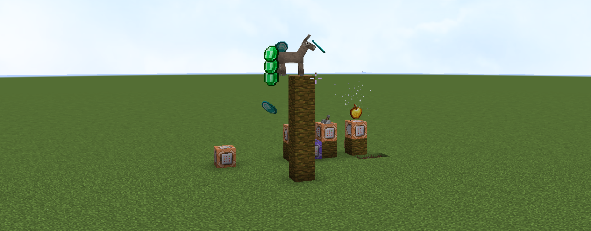
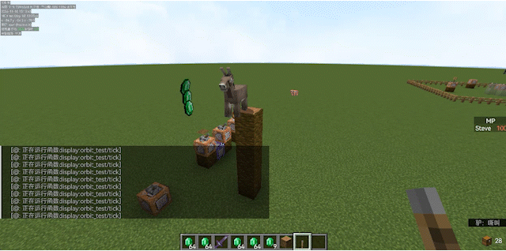
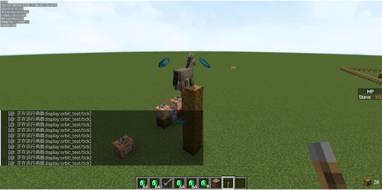
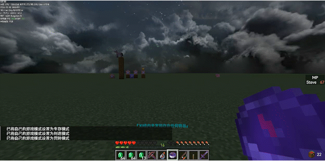

# 显示系统 (Display System)

---

## 系统概述

**显示系统（Display System）** 是一个基于 `item_display` 和 `block_display` 实体的可视化工具集，提供攻击范围预览、物品拾取、轨道运动等功能。

### 核心特性

- 📦 **物品拾取系统** - 地面物品的显示和拾取
- 🌀 **轨道运动** - 水平轨道、垂直轨道运动效果
- ⚙️ **高度可配置** - 使用宏函数，所有参数可自定义

轨道和物品展示在地图中的这个区域,`水平轨道和垂直轨道的旋转，拉下紫色的命令方块上的拉杆就可以查看了。
旁边的两个命令方块是为了初始化物品展示实体的。
最左边的黄色命令方块是用来清除物品展示实体的。









---

## 核心功能

### 1. 攻击范围显示(早期测试用此接口已废弃.敌人攻击范围显示,请调用 enemieskill 里的接口)

#### attack_range_cir - 圆形攻击范围

**路径**: `display:attack_range_cir`  
**类型**: 宏函数

**功能**: 在地面显示一个圆形攻击范围标记

**接口签名**:

```mcfunction
function display:attack_range_cir {
    s_x: "小数",    # X轴缩放（半径）
    s_y: "小数",    # Y轴缩放（厚度）
    s_z: "小数",    # Z轴缩放（半径）
    time: "整数",   # 显示时间（tick）
    tag: "标签"     # 自定义标签
}
```

---

#### attack_range_rec - 矩形攻击范围

**路径**: `display:attack_range_rec`  
**类型**: 宏函数

**功能**: 在实体前方显示一个矩形攻击范围标记

**接口签名**:
```mcfunction
function display:attack_range_rec {
    s_x: "小数",    # X轴缩放（宽度）
    s_y: "小数",    # Y轴缩放（高度）
    s_z: "小数",    # Z轴缩放（厚度）
    time: "整数",   # 显示时间（tick）
    tag: "标签"     # 自定义标签
}
```

---

### 2. 物品拾取系统

做这个其实是想复刻类银河恶魔城游戏里“,永久增加属性”的一个收集物功能.比如说,拾取一定数量的金胡萝卜,可以永久增加最大生命值.还有场景里的很多道具,比如说技能书,魂盘之类的,都可以通过这种形式放在地图里.可以让玩家看见一个大小比较大,会旋转且有粒子效果的可拾取物品,更有仪式感,可以给玩家更多的成就感.

#### item_summon - 召唤地面物品

**路径**: `display:item_summon`  
**类型**: 宏函数

**功能**: 在地面召唤一个可拾取的物品显示

**接口签名**:
```mcfunction
function display:item_summon {
    type: "物品ID",
    id_tag: "标签"
}
```

**物品类型映射**:
- `1` - 金西瓜
- `2` - 金萝卜
- `3` - 聚合钢

**实现原理**:
- 召唤 `item_display` 实体，位置略高于地面（`~0.1`）
- 添加 `item_on_world` 标签
- 使用 `item_display:none` 隐藏原版物品掉落框

**调用示例**:
```mcfunction
# 召唤金萝卜
function display:item_summon {type:"carrot",id_tag:"1"}

# 在特定位置召唤
execute positioned 100 64 200 run function display:item_summon {type:"carrot",id_tag:"2"}
```

---

#### item_show - 物品显示和拾取逻辑

**路径**: `display:item_show`  
**类型**: 普通函数（每tick执行）

**功能**: 
- 生成附魔粒子效果
- 检测玩家靠近（2格内）
- 触发拾取逻辑

**实现逻辑**:
```mcfunction
# 持续生成附魔粒子
particle enchant ~ ~0.8 ~ 0.4 0.7 0.4 0.05 5 normal

# 玩家离开时重置拾取计时器
execute unless entity @a[distance=..2] run scoreboard players set @s interval_pick_up 0

# 玩家靠近时触发拾取
execute if entity @a[distance=..2,gamemode=adventure] run function display:item_give
```

---

#### item_give - 物品给予

**路径**: `display:item_give`  
**类型**: 普通函数

**功能**: 给予玩家物品并播放效果

**实现逻辑**:

```mcfunction
# 拾取计时器递增
scoreboard players add @s interval_pick_up 1

# 12tick后才能真正拾取（防止误触）
execute if entity @s[scores={interval_pick_up=12..}] as @a[distance=..2,limit=1] run give @s emerald

# 播放拾取特效
execute if entity @s[scores={interval_pick_up=12..}] as @a[distance=..2,limit=1] run particle totem_of_undying ~ ~1 ~ 4 2 4 0.1 300
execute if entity @s[scores={interval_pick_up=12..}] as @a[distance=..2,limit=1] run playsound entity.player.levelup player 1 0.8 1 ~1

# 移除物品显示
execute if entity @s[scores={interval_pick_up=12..}] run kill @s
```

---

### 3. 轨道运动系统

#### horizontal_orbit - 水平轨道

**路径**: `display:other/horizontal_orbit`  
**类型**: 宏函数

**功能**: 让物体围绕中心点进行水平圆周运动

**接口签名**:

```mcfunction
function display:other/horizontal_orbit {
    tag: "标签",        # 物体标签
    r: "整数",          # 轨道半径（格）
    rotate: "小数f",    # 初始角度
    speed: "整数"       # 旋转速度
}
```

**实现原理**:
- 自动创建 `pivot`（轴心）实体
- 轴心持续旋转，物体跟随轨道运动
- 使用相对坐标 `^ ^ ^r` 计算物体位置
- 支持正向和反向旋转

**调用示例**:

```mcfunction
# 让苹果在半径1格的轨道上旋转，速度5
execute as @e[tag=apple] at @s run function display:other/horizontal_orbit {
    tag:"apple",
    r:"1",
    rotate:"10.0f",
    speed:"5"
}

# 多个物体环绕（护盾效果）
execute as @e[tag=shield_orb_1] at @s run function display:other/horizontal_orbit {
    tag:"shield_orb_1",
    r:"3",
    rotate:"0.0f",
    speed:"5"
}

execute as @e[tag=shield_orb_2] at @s run function display:other/horizontal_orbit {
    tag:"shield_orb_2",
    r:"3",
    rotate:"120.0f",
    speed:"5"
}

execute as @e[tag=shield_orb_3] at @s run function display:other/horizontal_orbit {
    tag:"shield_orb_3",
    r:"3",
    rotate:"240.0f",
    speed:"5"
}
```


---

#### vertical_orbit - 垂直轨道

**路径**: `display:other/vertical_orbit`  
**类型**: 宏函数

**功能**: 让物体围绕中心点进行垂直圆周运动

**接口签名**:
```mcfunction
function display:other/vertical_orbit {
    tag: "标签",    # 物体标签
    r: "整数",      # 轨道半径（格）
    h: "整数",      # 高度偏移
    speed: "整数"   # 旋转速度
}
```

**实现原理**:
- 创建垂直旋转的 `pivot`
- 物体在垂直平面上做圆周运动
- 使用 `^ ^h ^r` 控制高度和半径

**调用示例**:
```mcfunction
# 让物体在垂直面上旋转，半径3格
execute as @e[tag=orb] at @s run function display:other/vertical_orbit {
    tag:"orb",
    r:"3",
    h:"0",
    speed:"5"
}

# 环绕效果，带高度偏移
execute as @e[tag=guardian] at @s run function display:other/vertical_orbit {
    tag:"guardian",
    r:"4",
    h:"2",
    speed:"8"
}
```

---

#### vertical_orbit_90 - 垂直轨道90度修正

**路径**: `display:other/vertical_orbit_90`  
**类型**: 辅助函数

**功能**: 修正垂直轨道在90度和-90度时的旋转问题

**实现原理**:
- 检测 `x_rotation` 是否为 ±90
- 使用记分板计算修正角度（+180度）
- 调用 `filp` 函数应用修正

**注意**: 这是内部函数，由 `vertical_orbit` 自动调用

---

## 记分板系统

| 记分板 | 用途 |
|--------|------|
| `countDown` | 攻击范围显示倒计时 |
| `interval_pick_up` | 物品拾取计时器 |
| `temp` | 临时计算（轨道修正） |
| `temp1` | 临时计算辅助 |

---

## 标签系统

| 标签 | 用途 |
|------|------|
| `attack_range` | 攻击范围显示实体 |
| `item_on_world` | 地面可拾取物品 |
| `<tag>_pivot` | 轨道运动的轴心 |

---

## 接口总览表

| 接口 | 类型 | 主要参数 | 用途 |
|------|------|---------|------|
| `attack_range_cir` | 宏函数 | s_x, s_z, time | 圆形攻击范围 |
| `attack_range_rec` | 宏函数 | s_x, s_y, time | 矩形攻击范围 |
| `item_summon` | 宏函数 | type, id_tag | 召唤地面物品 |
| `item_show` | 普通函数 | 无 | 物品显示逻辑 |
| `item_give` | 普通函数 | 无 | 物品给予 |
| `horizontal_orbit` | 宏函数 | tag, r, rotate, speed | 水平轨道运动 |
| `vertical_orbit` | 宏函数 | tag, r, h, speed | 垂直轨道运动 |

---

