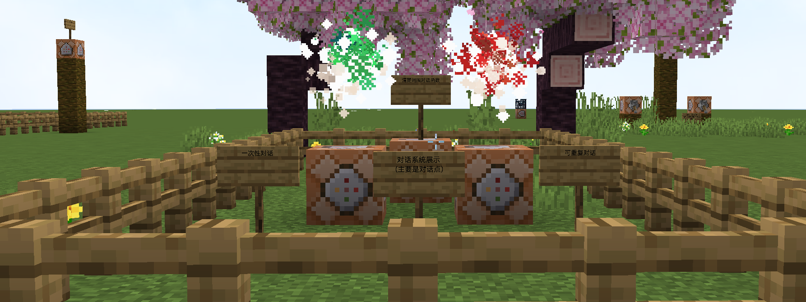

# 对话系统 - 通用召唤函数使用说明

## 📦 新功能：通用召唤对话实体

### 函数说明

```mcfunction
function talk:summon_talk_entity {n:"名字",isloop:0或1}
```

**参数**：
- `n` - 实体名字（用作tag标识）
- `isloop` - 对话模式
  - `0` = 一次性对话，对话结束后自动删除实体
  - `1` = 可重复对话，对话结束后可再次右键触发

`对话系统的展示如图所示，绿色按钮和红色按钮右击即可：
左边的绿色按钮是一次性的对话；
右边的红色按钮是重复的对话
`

后面的那个命令方块,它是清除这些对话实体的命令方块



---

## 🎮 使用示例

### 示例1：一次性对话,用于探索中的节点和引导
```mcfunction
# 在某个位置召唤一个一次性对话NPC
execute positioned 100 64 200 run function talk:summon_talk_entity {n:"quest_start",isloop:0}
```
玩家右键对话完成后，实体自动消失。

### 示例2：可重复对话,用于要一直留着的重要提示
```mcfunction
# 召唤一个可重复对话的商人
execute positioned 120 64 180 run function talk:summon_talk_entity {n:"merchant",isloop:1}
```
---

## 📝 创建新对话内容

### 步骤1：创建对话函数

在 `talk/functions/dialogue/` 下创建文件，例如 `merchant.mcfunction`：

```mcfunction
# 商人对话
execute if score @s temp matches 300 run tellraw @a [{"text":"[商人] ","color":"gold"},{"text":"欢迎！","color":"white"}]
execute if score @s temp matches 250 run tellraw @a [{"text":"[商人] ","color":"gold"},{"text":"看看我的商品。","color":"white"}]
execute if score @s temp matches 200 run tellraw @a [{"text":"[商人] ","color":"gold"},{"text":"价格公道！","color":"white"}]

# 对话结束
execute if score @s temp matches 1 run function talk:dialogue_end
```

**重点:**编写对话函数时,记得写好文本后,让ai处理间隔

```
间隔 tick = 10 + 字数 × 6
```

### 步骤2：注册到系统

编辑 `talk/functions/start_talk.mcfunction`：
```mcfunction
execute if entity @s[tag=merchant] run scoreboard players set @s temp 300
```

编辑 `talk/functions/countdown.mcfunction`：
```mcfunction
execute if entity @s[tag=merchant] run function talk:dialogue/merchant
```

### 步骤3：召唤实体

```mcfunction
execute positioned ~ ~ ~ run function talk:summon_talk_entity {n:"merchant",isloop:1}
```

---

## 🗑️ 清除对话实体

### 清除附近对话实体
```mcfunction
/function talk:clear_nearby_talk
```
删除玩家周围5格半径内的所有对话 interaction 与 marker，用于清理错误放置的对话实体。

---

## 🔧 技术细节

### 实体组成
1. **interaction** - 检测右键交互（width: 1.0, height: 1.5）
2. **marker** - 显示粒子特效（位于interaction中心上方0.75格）

### 记分板
- `temp` - 对话倒计时
- `isloop` - 对话模式（0或1）
- `detect_right1` - 右键时间戳

### 实体标签
- `talk` - 所有对话实体的通用标签
- `{n}` - 具体对话实体的标识（如 test_talk, merchant）
- `talk_particle` - 粒子marker的标签
- `{n}_particle` - 具体粒子marker的标识

### 

